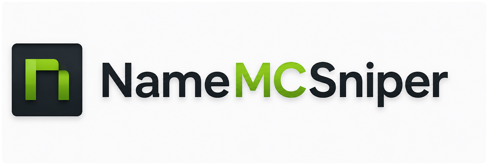

# NameMCSniper



NameMCSniper is a safe-by-default Python CLI for simulating timed Minecraft username claim workflows and, only when deliberately unlocked, issuing live username-change requests.

The current documented release is **v3.0.0**. The default mode is local simulation: it does not contact Minecraft, Discord, proxies, NTP, or internet time services, and it cannot change an account.


## Current Highlights

- **Safe simulation by default** - Test the worker, timing, rate-limit, and result paths without a Minecraft account or public network calls.
- **Easy CLI workflow** - Run `python Main.py easy` and answer guided prompts.
- **Explicit live safety lock** - Live claims require `--live` and a separate acknowledgement environment variable.
- **Scheduled NameMC timing** - Use copied NameMC drop times with explicit timezones.
- **Multiple account support** - Load one bearer token per line from `tokens.txt`.
- **Proxy file support** - Load HTTP(S) proxies from `proxies.txt` when proxy mode is enabled.
- **Discord webhooks** - Optional webhook notifications outside the precision timing path.
- **Local integration testing** - Fake Minecraft API support keeps verification offline and repeatable.

## Quick Start

```bash
git clone https://github.com/zwroee/NameMCSniper.git
cd NameMCSniper
python -m venv .venv
```

Windows:

```powershell
.\.venv\Scripts\python.exe -m pip install -r requirements.txt
.\.venv\Scripts\python.exe Main.py config-create
.\.venv\Scripts\python.exe Main.py easy
```

Linux/macOS:

```bash
.venv/bin/python -m pip install -r requirements.txt
.venv/bin/python Main.py config-create
.venv/bin/python Main.py easy
```

## Common Commands

| Command | Purpose |
|---------|---------|
| `python Main.py easy` | Guided simulation or live run |
| `python Main.py simulate` | Immediate offline simulation |
| `python Main.py snipe-at -u "TargetName" -w "9/15/2026 • 6:06:50 PM" --timezone America/New_York` | Scheduled dry run |
| `python Main.py config-validate` | Validate configuration |
| `python Main.py check-accounts` | Validate configured bearer tokens |
| `python Main.py check-proxies` | Validate configured proxies |
| `python Main.py benchmark` | Measure local timing precision |

## Documentation Sections

### Getting Started

- [Installation](getting-started/installation.md) - Set up the project and Python environment
- [Configuration](getting-started/configuration.md) - Understand `config.yaml`, `tokens.txt`, and `proxies.txt`
- [Authentication](getting-started/authentication.md) - Store bearer tokens safely

### Usage

- [Basic Usage](usage/basic-usage.md) - Run simulations, easy mode, and scheduled dry runs
- [Command Reference](usage/commands.md) - Current v3.0.0 command list
- [Discord Setup](usage/discord-setup.md) - Configure optional webhook notifications
- [Proxy Setup](usage/proxy-setup.md) - Configure HTTP(S) proxy loading and checks

### Advanced

- [How It Works](advanced/how-it-works.md) - Safety model, scheduling, and claim flow
- [Performance Optimization](advanced/performance.md) - Timing, worker, proxy, and clock notes
- [Troubleshooting](advanced/troubleshooting.md) - Common setup and runtime issues

## Important Notice

!!! warning "Use Responsibly"
    Live functionality can change a real Minecraft account username. Use it only where permitted, respect service limits and account restrictions, and keep tokens, webhooks, and proxies private.

## Support

Need help? Start with the [Troubleshooting](advanced/troubleshooting.md) guide, then use the support channels listed on the [Support](legal/support.md) page.
